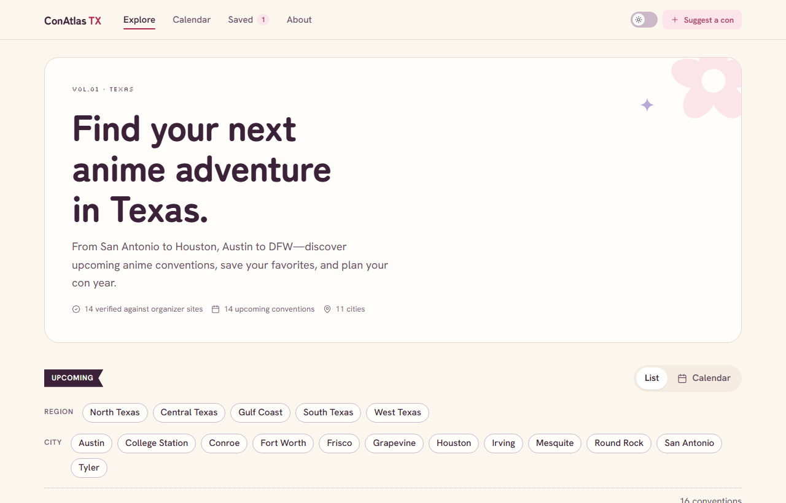
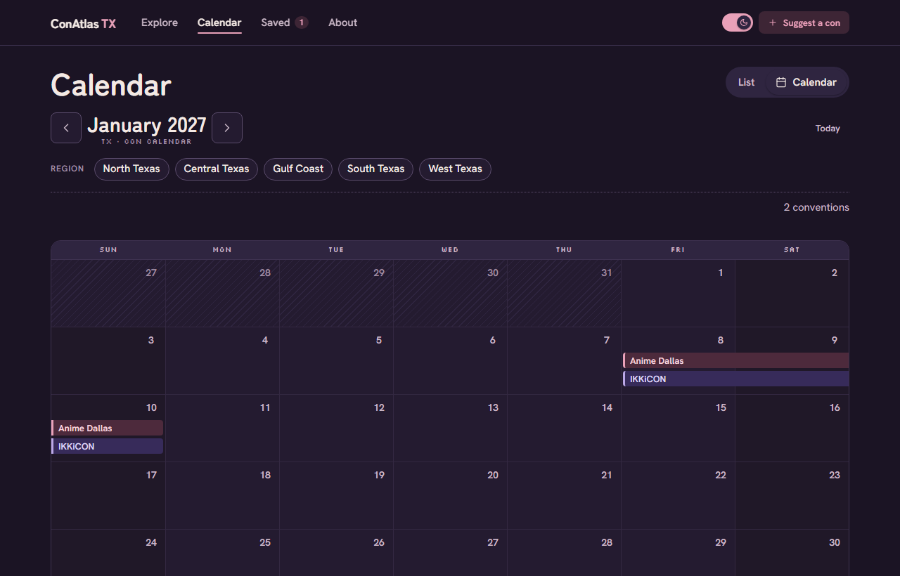
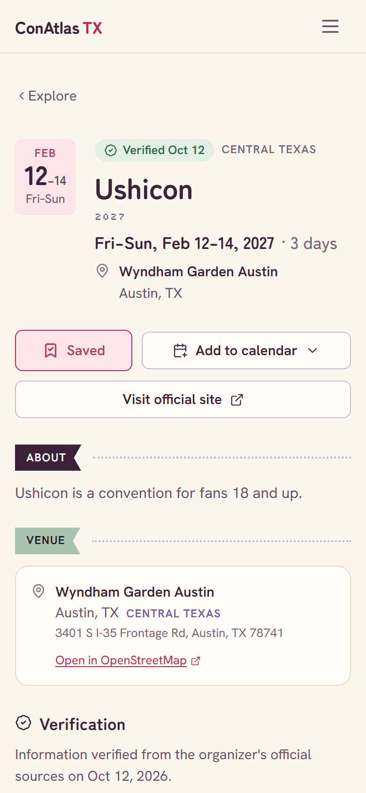

# ConAtlas TX

**Discover your next anime adventure.** Every anime convention in Texas on one calm page, with dates checked against each organizer's own site.

ConAtlas TX is a free, open-source convention calendar for fans, cosplayers and first-timers. No accounts, no tracking, and no guessed dates. If a con hasn't announced its weekend, we say so.

> **Status:** early development (milestone M3, data maintenance tools, in review). See [ROADMAP.md](ROADMAP.md).



<p>
  
  
</p>

## How it works

- Convention data lives in plain YAML files in [`data/`](data/README.md), versioned in Git.
- Every published date, venue and status needs an official source, and each listing shows when it was last checked.
- A maintainer reviews every change before it's published. Claude Code can help research updates, but nothing reaches the site without human approval.
- The site is static ([Astro](https://astro.build)), so it builds and runs without a server, database or AI service.

## Run it locally

You need [Node.js 24+](https://nodejs.org) and [pnpm](https://pnpm.io) (`npm install -g pnpm`). Works in PowerShell, Command Prompt or any Unix shell.

```sh
pnpm install
pnpm dev             # open http://localhost:4321/conatlas-tx/
```

| Command              | What it does                                  |
| -------------------- | --------------------------------------------- |
| `pnpm build`         | Build the static site into `apps/web/dist`    |
| `pnpm test`          | Run unit tests                                |
| `pnpm test:e2e`      | Browser smoke and axe checks (build first)    |
| `pnpm typecheck`     | Type-check every package and the site         |
| `pnpm lint`          | Lint with ESLint                              |
| `pnpm format`        | Format with Prettier                          |
| `pnpm data:validate` | Check every data file and cross-record rule   |
| `pnpm data:report`   | List conventions that are due for a re-check  |
| `pnpm data:diff`     | Compare staged drafts with the published data |

## Repository layout

```
apps/web            Astro site
packages/core       Schemas, date helpers, data validation
packages/ingestion  Data CLI (pnpm data:*)
packages/calendar   iCalendar helpers
data/               Convention data (YAML)
docs/brand/         Design system summary
```

## Contributing

Missing a con or spotted a wrong date? See [CONTRIBUTING.md](CONTRIBUTING.md). Everyone taking part follows the [Code of Conduct](CODE_OF_CONDUCT.md).

## License

Code is [MIT](LICENSE). Convention data in `data/` is [CC BY 4.0](https://creativecommons.org/licenses/by/4.0/): reuse it with attribution to ConAtlas TX. Convention names, logos and images belong to their organizers and are not covered by either license.
